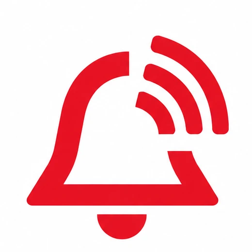
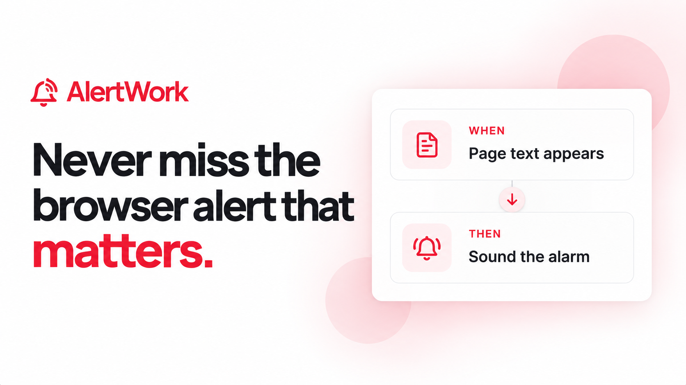

# AlertWork

**Privacy-first browser monitoring and automation for the pages that matter.**

[Add to Chrome](https://chromewebstore.google.com/detail/alertwork/pdnpndkfmldfhcpcpkpfpammkkcakfjd) · [Visit AlertWork](https://alertwork.online) · [View Dylan's portfolio](https://dylanfox.work)

## The product

AlertWork lets users select part of a web page, define what to watch for, and receive a desktop or audio alert when the condition changes. Monitoring runs locally, keeping the core workflow fast and private.

## What I built

- A guided rule builder for choosing pages, elements, and conditions
- Local page monitoring with desktop and audio notifications
- Optional actions for responding to matched conditions
- A web experience for onboarding, account management, and support
- Release workflows for a live Chrome Web Store product

I led the product strategy, workflow design, extension and web implementation, and launch.

## Repository note

This is a public product showcase. Production source code, automation logic, security controls, and infrastructure are maintained privately.

© 2026 Dylan Fox. All rights reserved.
